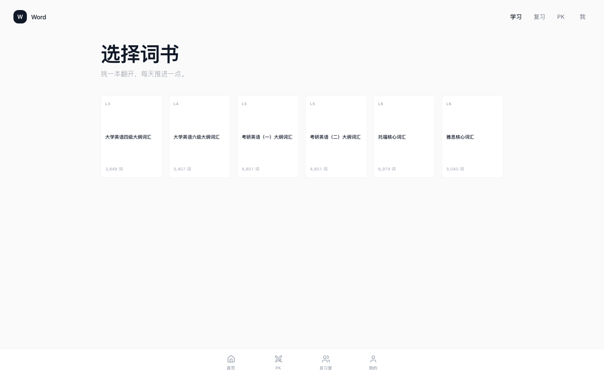
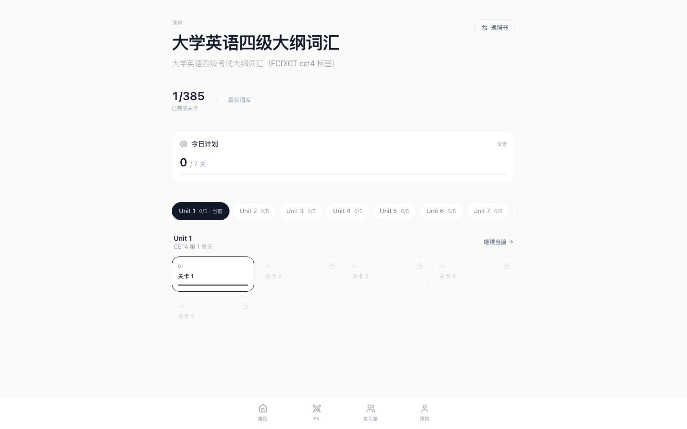
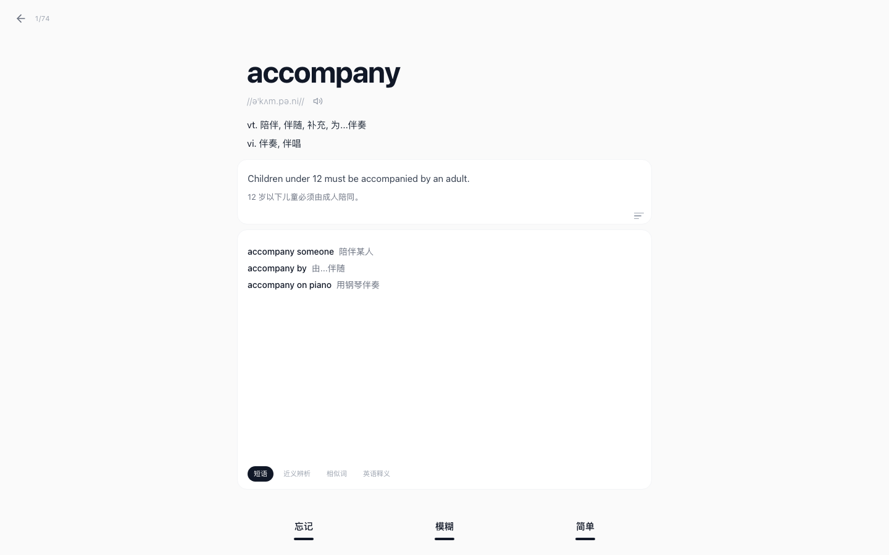
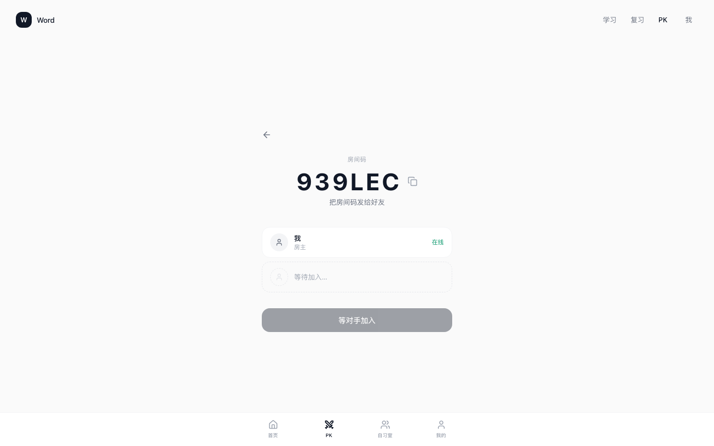
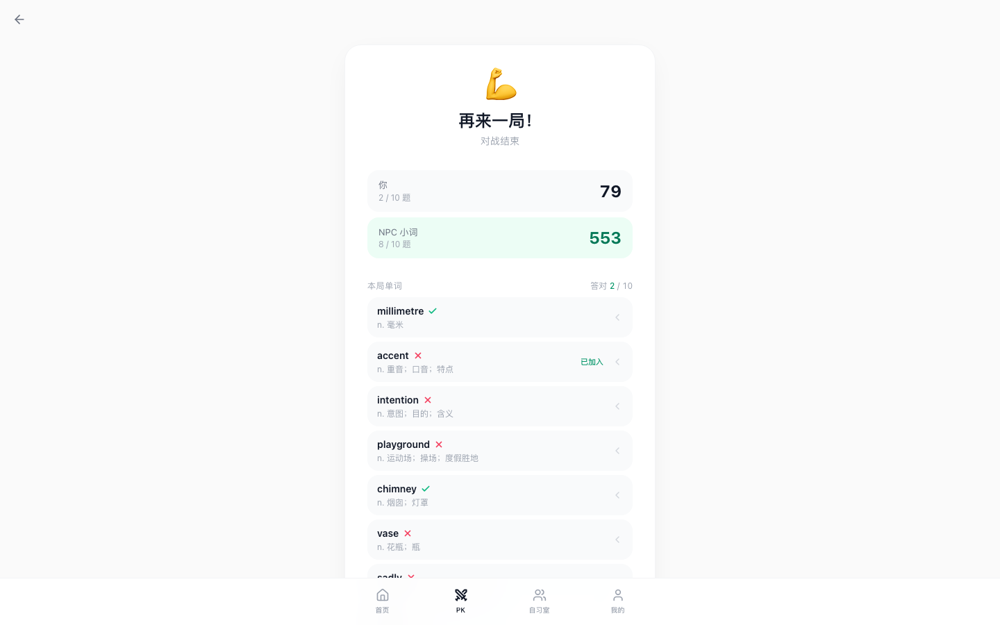
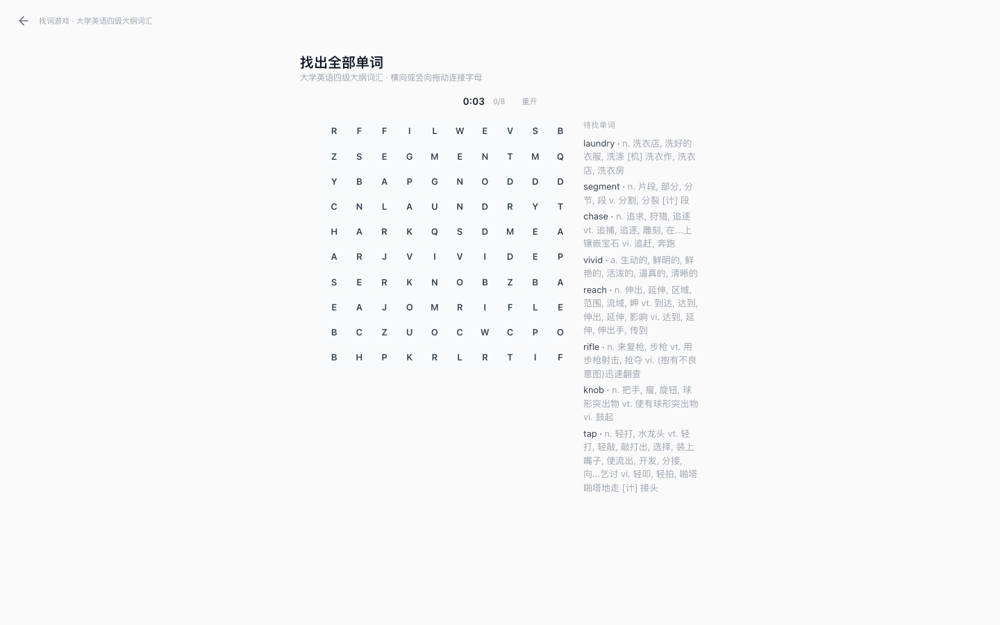
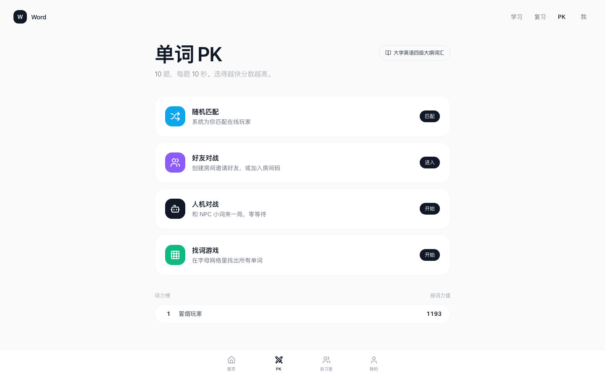
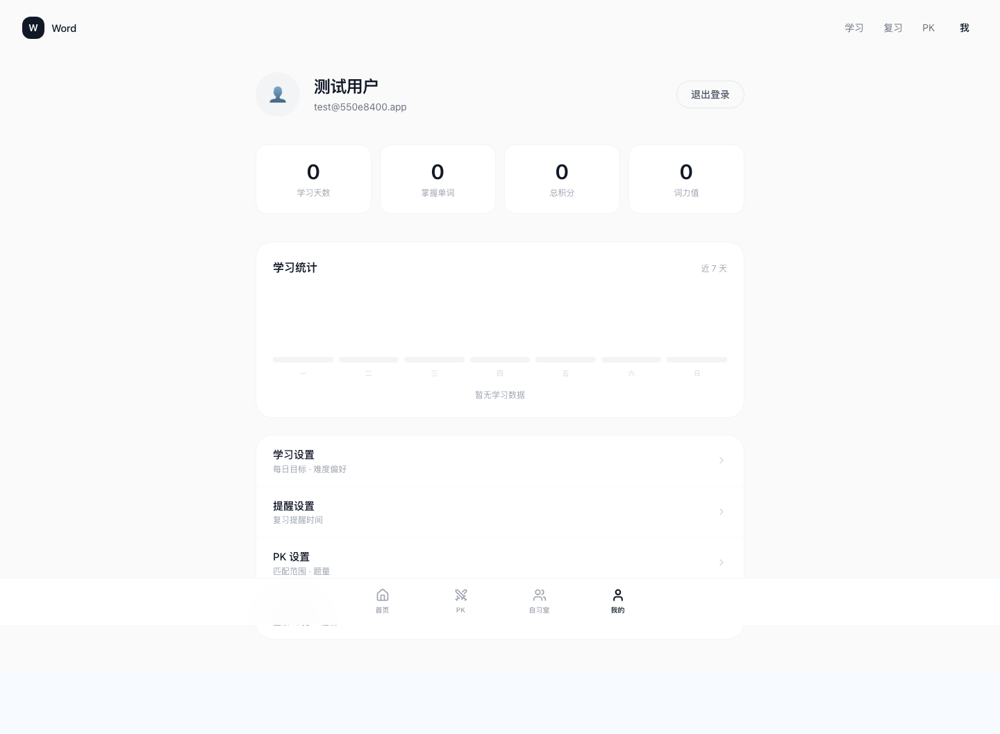

# Word Battle · 单词闯关学习平台

融合**闯关学习**、**FSRS 间隔重复复习**、**单词 PK 对战**的英语学习应用。
前端 Next.js，后端 Spring Boot（Java），数据库 PostgreSQL + Redis。

## 界面预览

| 首页 | 词书选择 |
| --- | --- |
|  |  |
| **课程关卡** | **FSRS 复习（评分界面）** |
|  |  |
| **PK 对战** | **好友对战房间** |
|  |  |
| **对战结算（错词自动加入复习）** | **找词游戏** |
|  |  |
| **PK 大厅（词力榜）** | **个人中心** |
|  |  |

## 核心功能

- **闯关学习**：6 本分级词书（四六级 / 考研 / 托福 / 雅思，共 10,689 词、2,918 关），单元-关卡两级结构，选择 / 听音 / 拼写等题型，生命值 + XP 积分。
- **FSRS 复习调度**：维护 stability / difficulty 双变量与 new → learning → review 状态机，按 4 档评分（忘记 / 困难 / 良好 / 简单）动态计算下次复习时间，到期队列 + 熟记移除。
- **单词 PK 对战**：人机对战、好友房间（房间码邀请）、随机匹配；按词书难度分组卷；速度分 + 正确率计分；错题自动进入复习队列。
- **每日签到**：Redis BitMap 每用户每天仅占 1 bit（一年约 46 字节），累计 / 连续 / 本月签到天数，个人页日历可视化。
- **词力值排行榜**：Elo 积分制，Redis ZSET 实时排名。
- **词库 LLM 富化**：批量调用 LLM 生成例句、搭配、近义辨析等深度内容，自研并发池 + 限速 + 单条失败隔离，结果校验后写回 JSONB。

## 架构

```
浏览器 (Next.js 14 / React 18)
   │  REST (JWT)                    WebSocket /ws/pk（对手作答事件推送）
   ▼                                     ▲
Spring Boot 3.3.5 ────────────────┘
   │            │                │
   ▼            ▼                ▼
PostgreSQL   Redis            LLM API
(JPA/JSONB)  (缓存三件套 /       (词库富化，
             BitMap 签到 /      离线批量管线)
             Lua 幂等 / ZSET 排行榜 /
             JWT 登出黑名单)
```

- **认证**：JWT 无状态认证（jBCrypt 存储密码），登出后将 token 写入 Redis 黑名单主动失效；未登录访问降级为内置演示用户。
- **缓存三件套**：词书 / 统计等全局只读接口走统一 `CacheService`——空结果短 TTL 占位防**穿透**、`SET NX EX` 互斥 + 双检查重建防**击穿**、TTL 随机抖动防**雪崩**；响应带 `X-Cache: HIT/MISS/NULL/DEGRADED` 头，Redis 故障 fail-open 直查库。用户级数据（课程树含个人进度）明确不走全局缓存。
- **提交幂等（Lua）**：前端按 `(userId, roomId, questionId)` 生成确定性幂等键，Lua 脚本原子"检查 + 占位"，重复提交直接返回已存结果、不打 DB；结果回写在事务提交后（`afterCommit`）执行，Redis 故障退化为 DB 查重兜底。
- **每日签到（BitMap）**：`SETBIT` 返回置位前旧值，仅旧值为 0 时才 `INCR` 累计计数器——天然防并发重复累计；连续天数为纯函数（可单测）；月历数据一次 pipeline 取回，避免逐天 GETBIT 往返。
- **PK 并发正确性**：加入房间走 `SELECT ... FOR UPDATE` 悲观锁串行化，配合 `(room_id, seat_no)` 部分唯一索引与 `(room_id, user_id)` 唯一约束兜底——锁保证效率，约束保证正确性。
- **实时对战**：提交答案走 HTTP POST 保证幂等落库，事务提交后（`afterCommit`）通过 WebSocket 广播"对手已作答"事件；前端保留 700ms 轮询作为降级，断线 3s 自动重连。
- **复习调度**：FSRS 简化版独立为纯函数类（`FsrsCalculator`），接口稳定、可替换为完整 FSRS-6 实现。
- **演示模式**：不配置后端地址时，前端自动切换为内存 mock 数据，完整流程可脱离数据库运行。

## 技术栈

| 层 | 技术 |
| --- | --- |
| 前端 | Next.js 14（App Router）、React 18、TypeScript、Tailwind CSS、Zustand |
| 后端 | Spring Boot 3.3.5、Spring Data JPA（JSONB）、Bean Validation、jjwt |
| 数据 | PostgreSQL（JSONB 半结构化字段）、Redis（缓存三件套 / BitMap / Lua / ZSET） |
| 实时 | 原生 WebSocket（`TextWebSocketHandler`）+ HTTP 轮询降级 |
| 测试 | JUnit 5 + Mockito，47 个单元测试覆盖 FSRS 调度、PK 组卷/Elo、缓存行为、签到连续天数、认证 |
| 部署 | Docker 多阶段构建、docker-compose（PostgreSQL + Redis + 后端 + 前端）、GitHub Actions CI |

## 快速开始

### 方式一：Docker Compose 一键启动

```bash
docker compose up --build
# 前端 http://localhost:3000  后端 http://localhost:8080
```

包含 PostgreSQL 18（自动建表）、Redis 7、Java 后端、Next.js 前端四个服务。
注意：镜像内只初始化了表结构，词库数据需另行导入。

### 方式二：本地开发

前置：JDK 21、Maven、PostgreSQL、Redis。

```bash
# 1. 数据库：创建 word_battle 库，执行 backend-java/docker/postgres-init/01-schema.sql 建表

# 2. 启动后端（默认连接 localhost:5432/word_battle 与 localhost:6379）
cd backend-java
mvn spring-boot:run

# 3. 启动前端
cd word-battle-app
echo 'NEXT_PUBLIC_JAVA_API_URL=http://localhost:8080' > .env.local
npm install
npm run dev
```

### 方式三：纯前端演示模式

不配置 `NEXT_PUBLIC_JAVA_API_URL` 直接 `npm run dev`，前端使用内存 mock 数据，无需后端与数据库。

## 测试

```bash
cd backend-java
mvn test    # 47 个单元测试：FSRS 状态机、组卷/干扰项、Elo 计分、缓存三件套行为、签到连续天数、JWT 认证分支
```

## 项目结构

```
word-battle-app/
├── app/                    # Next.js 页面（courses / review / pk / profile）
├── components/             # React 组件
├── lib/                    # api-client、mock-api、工具
├── backend-java/           # Spring Boot 后端
│   └── src/main/java/com/wordbattle/
│       ├── auth/           # JWT 认证 + Redis 黑名单
│       ├── lesson/         # 闯关/词书/课程
│       ├── review/         # FSRS 复习调度
│       ├── pk/             # 对战：房间/组卷/计分/WebSocket/排行榜
│       ├── enrich/         # LLM 词库富化管线
│       ├── user/           # 用户/统计
│       └── common/         # 统一响应/全局异常
├── docker-compose.yml      # PostgreSQL + Redis + 后端 + 前端
└── .github/workflows/      # CI：后端 mvn test（带 PG/Redis 服务）+ 前端 tsc/build
```

## 参考

项目设计与实现过程中参考了以下开源项目：

- [sanidhyy/duolingo-clone](https://github.com/sanidhyy/duolingo-clone)（闯关模式）
- [arleyGuoLei/wechat-app-words-pk](https://github.com/arleyGuoLei/wechat-app-words-pk)（单词对战）
- [open-spaced-repetition/fsrs4anki](https://github.com/open-spaced-repetition/fsrs4anki)（FSRS 算法）
